# From Neural Networks to PINNs, VPINNs and gPINNs

[](https://doi.org/10.5281/zenodo.23316186)
   
**A step-by-step, fully reproducible PyTorch tutorial that shows *why* each method was invented by showing *where the previous one fails*.**

[](https://github.com/Somnath20000/From-NN-to-PINNs-VPINNs-gPINNs/actions/workflows/tests.yml)


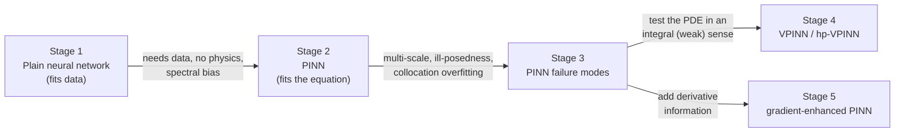

Every script is self-contained, heavily commented, and written so that someone who is **not** an experienced programmer can run it, read it top to bottom, change one setting, and run it again.

---

## Contents
1. [Quick start](#1-quick-start)
2. [How every script is organised](#2-how-every-script-is-organised)
3. [The story, stage by stage (with our results)](#3-the-story-stage-by-stage)
4. [Summary of results](#4-summary-of-results)
5. [Repository layout](#5-repository-layout)
6. [Honest limitations](#6-honest-limitations)
7. [References](#7-references)
8. [Citation](#8-citation)

---

## 1. Quick start

```bash
# 1. get the code
git clone https://github.com/Somnath20000/From-NN-to-PINNs-VPINNs-gPINNs.git
cd From-NN-to-PINNs-VPINNs-gPINNs

# 2. (recommended) create a virtual environment
python -m venv .venv
source .venv/bin/activate            # Windows: .venv\Scripts\activate

# 3. install the dependencies (CPU-only PyTorch is enough; for a GPU install a CUDA build from pytorch.org)
pip install torch --index-url https://download.pytorch.org/whl/cpu
pip install -r requirements.txt

# 4. run ONE script (always from the repository root folder)
python 02_pinns/pinn_01_first_order_ode.py

# 5. ...or all of them in order (about 30-45 minutes on a laptop CPU)
python run_all.py
python run_all.py --stage 3          # only Stage 3
python run_all.py --quick            # 1-minute smoke test: checks everything runs
```

Each script prints its progress, and at the end a **SUMMARY** with the final errors. Figures and a `summary.json` are saved next to the script, in `<stage folder>/figures/<script name>/` (e.g. `01_neural_networks/figures/nn_01_data_hungry/`).

Run the tests with `pytest -q tests`.

---

## 2. How every script is organised

All scripts follow the same layout, so once you have read one you can read them all:

| Part of the file | What it contains |
|---|---|
| Header (docstring) | **QUESTION / PROBLEM** (the maths), **WHAT YOU SHOULD SEE**, **HOW TO RUN**, **THINGS TO TRY** |
| `1. Settings` | Every number you might want to change (network size, number of points, weights…) in one place |
| `2. Problem` | Exact solution, forcing term, boundary data (from `common/problems.py`) |
| Model and loss | The network (`MLP`) and a `loss_fn()` that returns each loss term |
| Training | One call to `train(...)` from `common/training.py` (Adam, optional L-BFGS) |
| Evaluation | Relative L2 errors, plots, `summary.json` |

**Command-line options that work for every script**

| Option | Meaning | Example |
|---|---|---|
| `--epochs N` | number of Adam iterations | `--epochs 5000` |
| `--lr X` | Adam learning rate | `--lr 5e-4` |
| `--seed N` | random seed (initial weights and random points) | `--seed 7` |
| `--lbfgs N` | extra L-BFGS iterations after Adam (often improves accuracy) | `--lbfgs 2000` |
| `--quick` | very short run to check nothing crashes (results go to `<stage folder>/figures/quick/`) | `--quick` |
| `--device D` | where to train: `auto` (default: GPU if available, otherwise CPU), `cpu` or `cuda` | `--device cpu` |
| `--help` | list all options of that script, including script-specific ones | `--help` |

The error measure everywhere is the **relative L2 error** `||u_pred − u_exact|| / ||u_exact||` on a fine test grid (0.01 = 1 %).
All computations use double precision (`float64`) and fixed seeds, so re-running gives the same numbers on the same machine (small differences across hardware/library versions are normal).

---

## 3. The story, stage by stage

The numbers below are from our run on a CPU with the default settings (`python run_all.py`). They are the values stored in each `<stage folder>/figures/<script name>/summary.json`. Your numbers may differ slightly.

### Stage 1 — Plain neural networks (`01_neural_networks/`)

A neural network is a universal approximator, so why not just fit the solution?

**`nn_01_data_hungry.py`**: learn `u(x) = −(1.4 − 3x) sin(18x)` from samples.

| | 100 samples | 10 samples |
|---|---|---|
| error of u on [0, 1] | 1.2 % | **29 %** |
| error of u′ on [0, 1] | 7.3 % | **54 %** |
| error on [1, 1.3] (extrapolation) | 110 % | 166 % |
| final training loss (10 samples) | | 4.2e-5 |

The 10-sample network passes through every sample (loss ≈ 0) and is still wrong. **A small loss is not a correct model.**

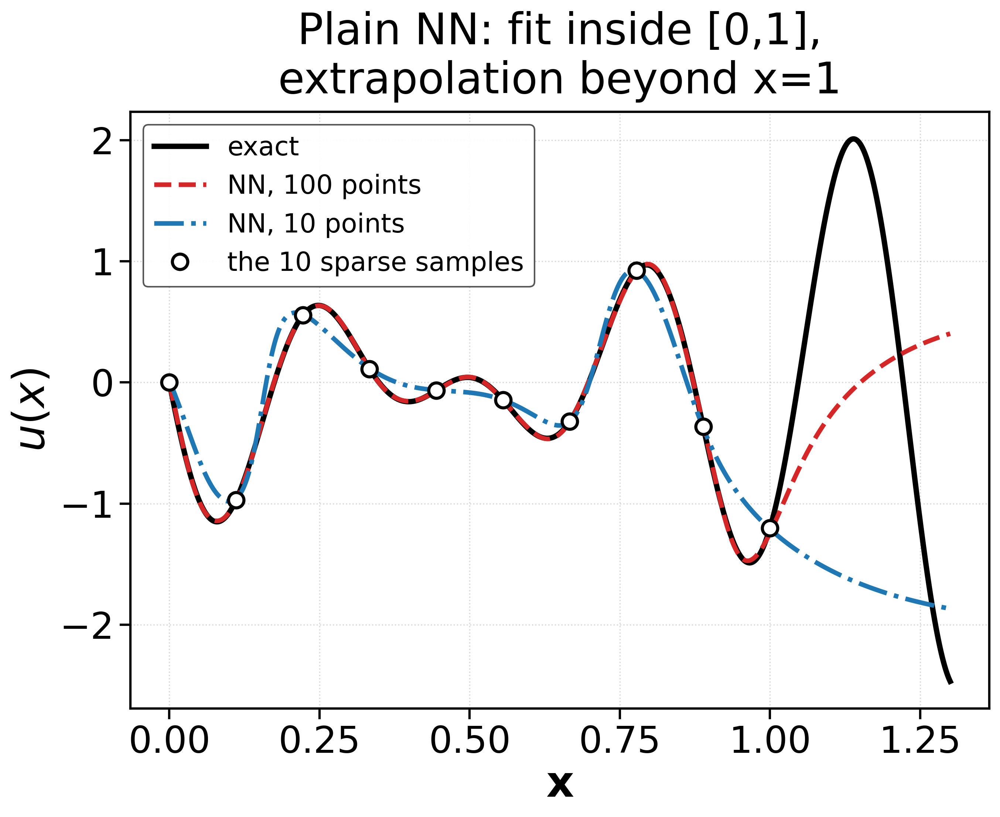

**`nn_02_spectral_bias.py`**: even with 256 samples, the slow wave (frequency 1) is learned within ~300 iterations, the fast wave (frequency 10) only after ~3 400. This *spectral bias* (Rahaman et al., 2019) returns in Stage 3.

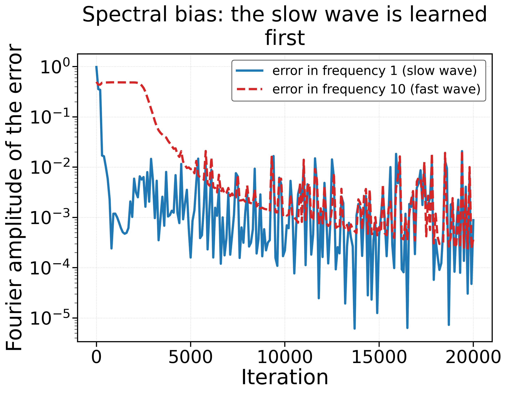

### Stage 2 — Physics-Informed Neural Networks (`02_pinns/`)

A PINN (Raissi, Perdikaris & Karniadakis, 2019) minimises the **residual of the equation** at *collocation points*, which need no labels:

$$\mathcal{L}(\theta) = \frac{1}{N}\sum_{j=1}^{N} \big|\mathcal{N}[u_\theta](x_j) - f(x_j)\big|^2 + w_{bc}\,\frac{1}{N_b}\sum_{i} \big|u_\theta(x_i^b) - g(x_i^b)\big|^2 ,$$

where the derivatives in $\mathcal{N}[u_\theta]$ are computed exactly by automatic differentiation.

| Script | Problem | Result |
|---|---|---|
| `pinn_01_first_order_ode.py` | `y′ = −5y`, `y(0) = 1`, no interior data | PINN error **0.097 %** vs. plain NN with 4 data points 5.0 % |
| `pinn_02_poisson_1d.py` | `−u″ = f` on (0, π), 50 collocation points | PINN error **3.6e-5** (u) and 1.5e-4 (u′) vs. plain NN with 15 data points 0.90 % (u) and 17 % (u′) |
| `pinn_03_poisson_2d_hard_bc.py` | 2-D Poisson, peak `[16x(1−x)y(1−y)]^4`, BC built into the network | error **0.15 %** with 400 random points, boundary error exactly 0 |

*Hard boundary conditions*: writing `u = x(1−x)y(1−y)·N(x, y)` makes `u = 0` on the boundary for any weights (Lagaris et al., 1998), so no boundary loss or weight is needed.

### Stage 3 — Where PINNs fail (`03_pinn_failures/`)

| Script | Failure mode | What we measured |
|---|---|---|
| `fail_01_multiscale.py` | **Multi-scale solution** `u = 0.1 sin(8πx) + tanh(5πx)`, 100 random collocation points, 4 seeds | Single-scale version `tanh(5πx)`: 0.070 %. Multi-scale: **2.3 %, 4.6 %, 15 %, 71 %** depending only on the seed. The worst run (71 %, seed 2) has a *smaller* PDE loss (2.4e-2) than the 4.6 % run (seed 1, 2.8e-2). |
| `fail_02_neumann_nonuniqueness.py` | **Ill-posed problem**: `−u″ = 2`, `u′(0) = 0`, `u′(1) = −2` (solution only defined up to a constant) | Loss ≈ 2–4e-7 in every run, but constants C = 3.57, 3.37, 3.72 → error ≈ 460–510 %. Adding the anchor `u(0) = 1`: error 0.004 %. |
| `fail_03_collocation_overfitting.py` | **Collocation overfitting** on the sharp 2-D peak (`a = 10`), 400 points | PDE residual 0.011 at the training points vs. **67.7 at 10 000 unseen points** (6 300× larger); solution error 17.6 %. |

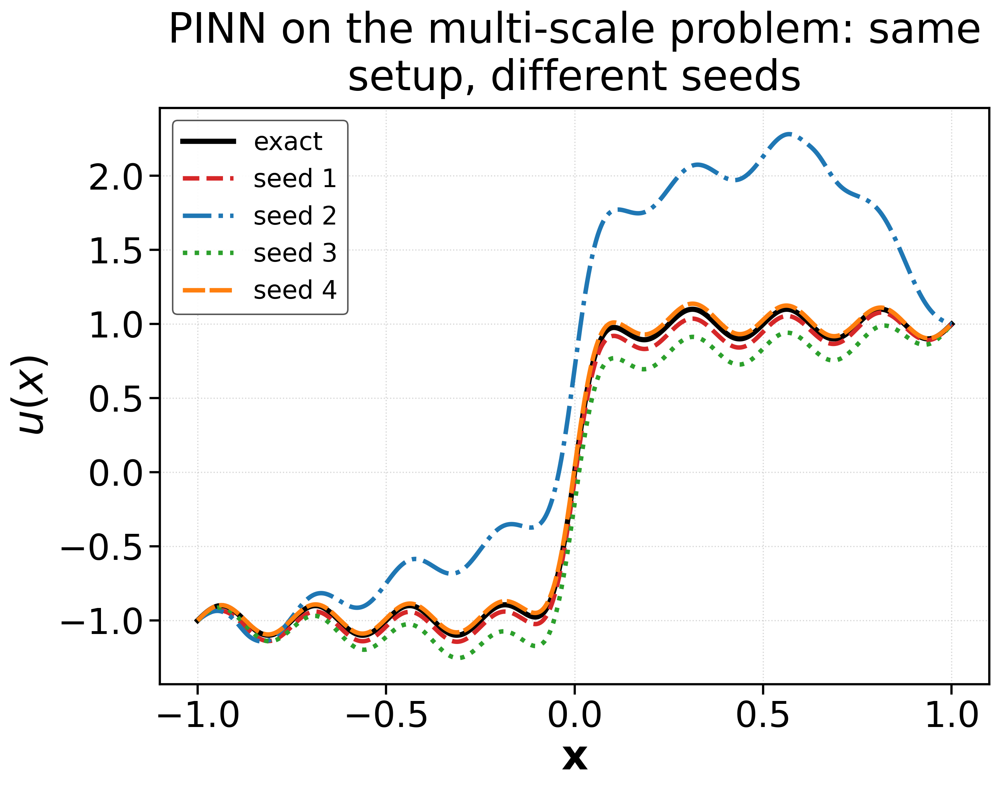 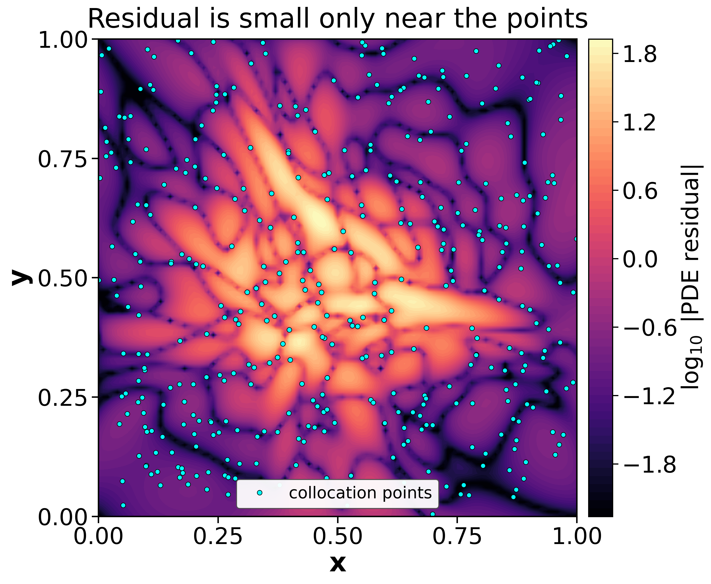

**Lesson:** the PINN loss is evaluated only at finitely many points and does not check well-posedness. A small loss is not a certificate of a correct solution. Known remedies include more or resampled points, loss balancing, Fourier features, domain decomposition, and the two directions below. See Wang, Teng & Perdikaris (2021) and Krishnapriyan et al. (2021) for systematic studies.

### Stage 4 — Variational PINNs (`04_vpinns/`)

A VPINN (Kharazmi, Zhang & Karniadakis, 2019, 2021) tests the residual against smooth **test functions** $v_k$, as the finite-element method does:

$$R_k = \int_\Omega \big(\mathcal{N}[u_\theta] - f\big)\, v_k \, dx, \qquad \mathcal{L} = \sum_{e}\frac{1}{K}\sum_{k=1}^{K} R_{e,k}^2 + w_{bc}\,\mathcal{L}_{bc}.$$

Here $v_k = P_{k+1} - P_{k-1}$ (Legendre polynomials, which vanish at the element ends), and the integrals use Gauss–Lobatto–Legendre quadrature. Integrating by parts moves derivatives from the network onto $v_k$. For $-u'' = f$ that gives three forms:

| form | residual | network derivatives needed |
|---|---|---|
| 1 | $\int -u'' v_k - \int f v_k$ | 2nd |
| 2 | $\int u' v_k' - \int f v_k$ | 1st |
| 3 | $-\int u\, v_k'' + [u\, v_k'] - \int f v_k$ | none |

**`vpinn_01_multiscale_1d.py`**: the multi-scale problem of `fail_01`, with the same network, optimiser, seeds and a comparable number of points (80 quadrature points vs. 100 collocation points).

| seed | PINN (fail_01) | VPINN form 1 | VPINN form 3 |
|---|---|---|---|
| 1 | 4.6 % | 0.22 % | **0.16 %** |
| 2 | 71 % | **101 %** ✗ | **0.12 %** |
| 3 | 15 % | 0.036 % | **0.028 %** |
| 4 | 2.3 % | 0.12 % | **0.24 %** |
| cost per iteration | – | 0.89 ms | 0.62 ms |

Form 3 is accurate for every seed and is also the cheapest. (When form 1 works, it is about as accurate.) Form 1 still fails for one seed: it evaluates $u_\theta''$ only at the quadrature points, and the network can develop wiggles *between* them that the quadrature cannot see (aliasing). Integrating by parts, or using more quadrature points (`--n_quad 160`) or more elements, removes the failure for that seed. **VPINNs are not magic, but the weak form gives a much more reliable loss here.**

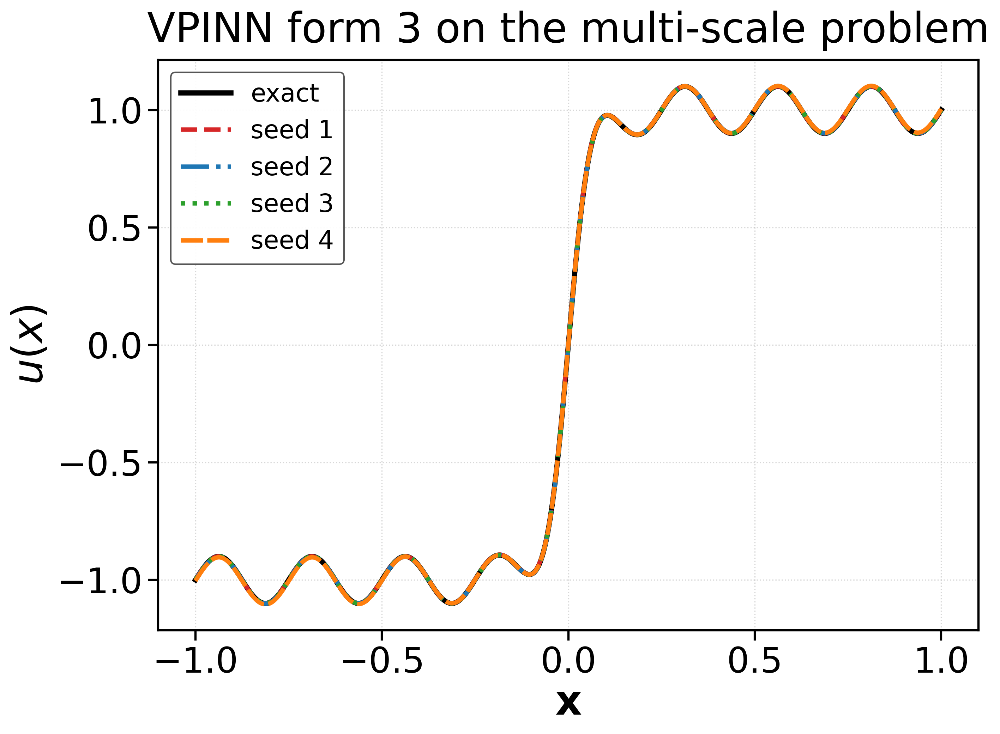 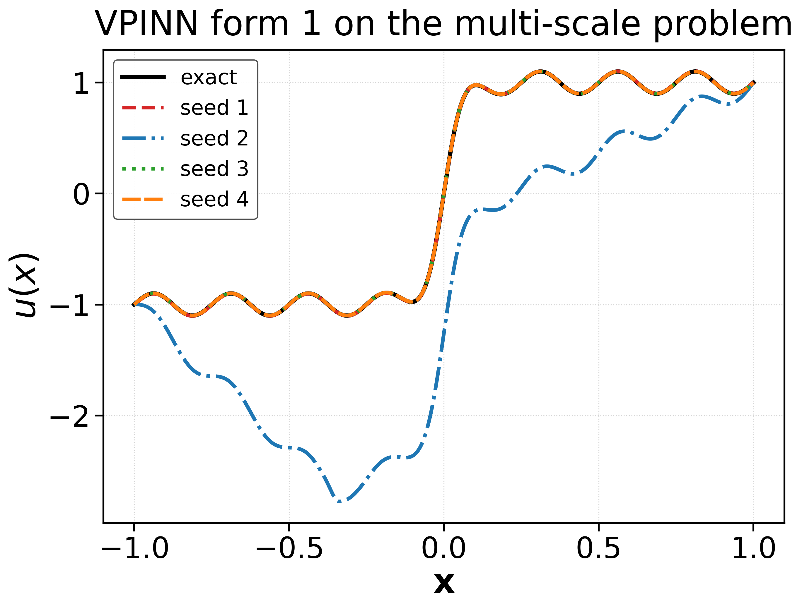

**`vpinn_02_hp_poisson_2d.py`** compares an hp-VPINN with a PINN on `u = (0.1 sin 2πx + tanh 10x) sin 2πy` on [−1, 1]². The hp-VPINN uses 4×4 elements with 10×10 test functions each. Both use the same network, boundary points and weight.

| method | error |
|---|---|
| hp-VPINN (4×4 elements) | **1.9 %** |
| PINN, 100 residual points (as in the original hp-VPINN code) | 61 % |
| PINN, 1 600 residual points (`--method pinn --n_res 1600`) | **0.95 %** |

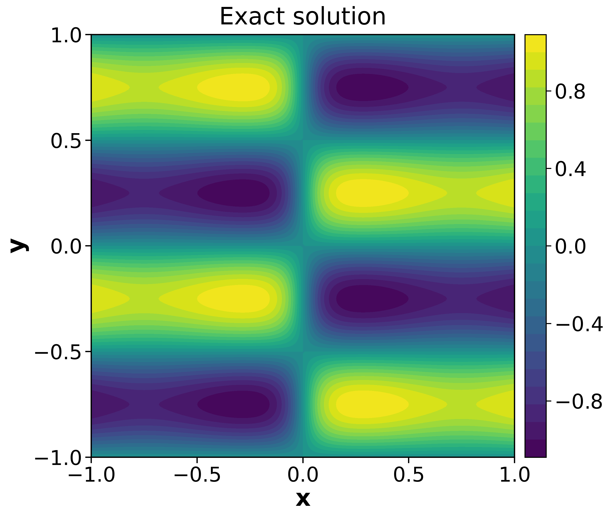 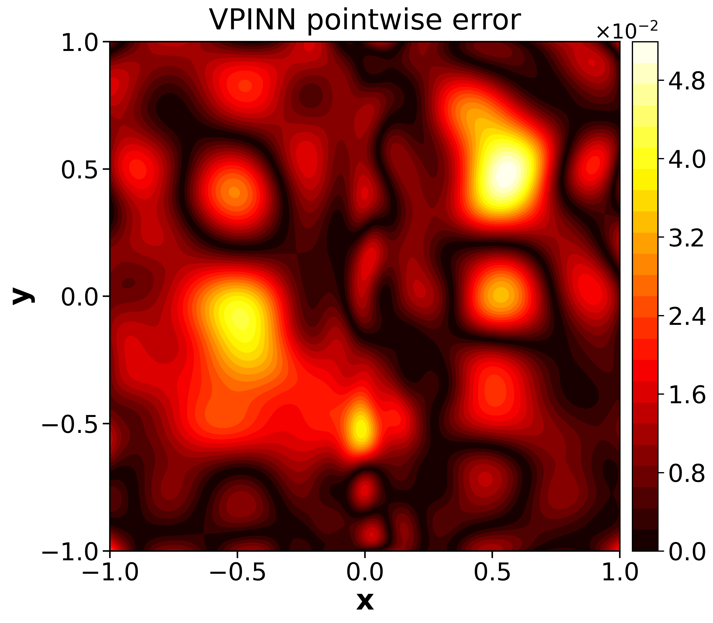 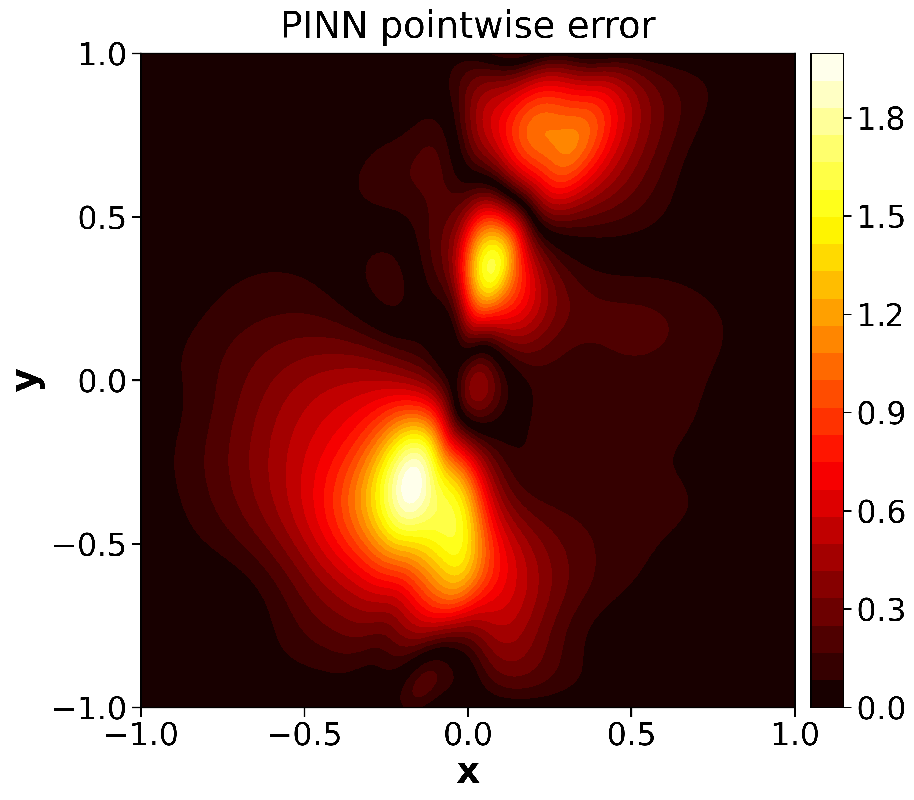

*Left to right: exact solution, hp-VPINN error, PINN (100 points) error. Each error map has its own colour range.*

**Be careful with this comparison.** Against the 100-point PINN used in the original hp-VPINN code, the hp-VPINN wins by a wide margin. But a PINN with 1 600 points beats the hp-VPINN in our run (0.95 % vs. 1.9 %) at a similar wall-clock time (238 s vs. 201 s for 20 000 iterations). For smooth 2-D problems, brute-force collocation is a strong baseline. The more robust advantage of the weak form in this repository is the 1-D multi-scale case above, where it was reliable across seeds while the PINN was not. Always compare methods at matched cost, not only at matched settings.

**`vpinn_03_neumann_natural_bc.py`**: in the weak form, Neumann data enter *naturally* through the boundary term: $\int u'v' = \int f v + g_R v(1) - g_L v(0)$. To keep that term, two linear "hat" test functions that do not vanish at the ends are added.

| treatment | error |
|---|---|
| bubbles + Neumann penalty + anchor | 0.33 % |
| **natural BC** (Neumann data in the weak form) + anchor | **0.0085 %** |
| natural BC, no anchor | 412 % (constant offset C = 3.01: the non-uniqueness of fail_02 is a property of the PDE) |

Here the natural treatment is about 40× more accurate than the penalty, with one loss weight fewer.

### Stage 5 — Gradient enhancement, a different perspective (`05_gradient_enhanced/`)

Instead of changing *how* the equation is tested, a gPINN (Yu, Lu, Meng & Karniadakis, 2022) adds *more information*: if $r = \mathcal{N}[u_\theta] - f$ vanishes everywhere, so does its gradient.

$$\mathcal{L} = \overline{r^2} + w_g\, \overline{|\nabla r|^2} + \mathcal{L}_{bc}.$$

| Script | Setting | PINN / plain NN | gradient-enhanced |
|---|---|---|---|
| `gpinn_01_function_approximation.py` | fit `−(1.4−3x) sin 18x` from 12 samples (+ derivative data) | u: 22 %, u′: 47 % | w = 0.01: u 2.3 %, u′ 5.5 %; uncertainty weighting: **u 2.1 %, u′ 1.6 %** |
| `gpinn_02_poisson_1d.py` | `−u″ = f`, only 15 collocation points, w_g = 0.01 | u: 3.0 %, u′: 9.9 % | **u: 0.31 %, u′: 0.75 %** |
| `gpinn_03_poisson_2d.py` | sharp 2-D peak of fail_03, w_g = 0.01 | 50 % | **1.4 %** (≈2.5× cost per iteration) |

*Note on gpinn_03:* the PINN error here (50 %) differs from fail_03 (17.6 %) on the same problem, because the 400 random collocation points are a different draw (the random-number state differs between the scripts). That spread is itself another symptom of the collocation sensitivity shown in Stage 3. The gPINN and PINN *inside* gpinn_03 use identical points and initial weights.

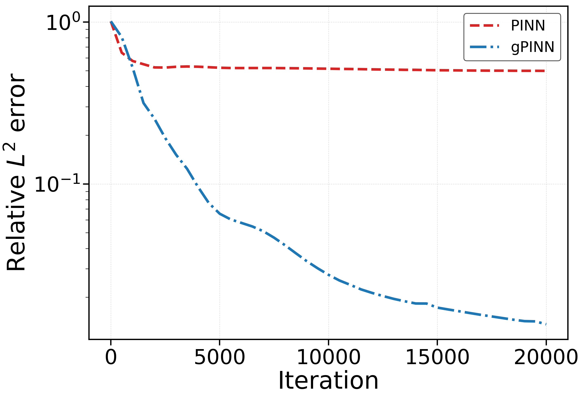

Two practical notes are built into the scripts:
* **Weight choice.** The gradient terms can be orders of magnitude larger than the residual (here ∇f is ~10× larger than f). Scale $w_g$ so that both contributions are comparable.
* **Learnable weights.** A weight `exp(s)` minimised together with the loss can only decrease, because $\partial\mathcal{L}/\partial s = e^{s} L_g > 0$. Its optimum is 0, which switches the gradient term off. `gpinn_01` demonstrates this and uses uncertainty weighting (Kendall et al., 2018) instead, which has a non-trivial optimum.

---

## 4. Summary of results

| Stage | Script | Key number (default settings) |
|---|---|---|
| 1 | `nn_01_data_hungry` | 10 samples: 29 % error although training loss ≈ 4e-5 |
| 1 | `nn_02_spectral_bias` | slow wave learned after ~300 its, fast wave after ~3 400 |
| 2 | `pinn_01_first_order_ode` | PINN 0.097 % with zero interior data |
| 2 | `pinn_02_poisson_1d` | PINN 3.6e-5 vs. plain NN 0.90 % |
| 2 | `pinn_03_poisson_2d_hard_bc` | 0.15 % with hard BC |
| 3 | `fail_01_multiscale` | 2.3 %–71 % depending on the seed |
| 3 | `fail_02_neumann_nonuniqueness` | loss ~3e-7 but error ≈ 500 % without anchor |
| 3 | `fail_03_collocation_overfitting` | unseen residual 6 300× the training residual |
| 4 | `vpinn_01_multiscale_1d` | form 3: 0.028 %–0.24 % for all seeds |
| 4 | `vpinn_02_hp_poisson_2d` | hp-VPINN 1.9 % vs. PINN 61 % (100 pts) / 0.95 % (1 600 pts) |
| 4 | `vpinn_03_neumann_natural_bc` | natural BC 0.0085 % (penalty 0.33 %) |
| 5 | `gpinn_01_function_approximation` | 22 % → 2.1 % with derivative information |
| 5 | `gpinn_02_poisson_1d` | 3.0 % → 0.31 % |
| 5 | `gpinn_03_poisson_2d` | 50 % → 1.4 % on the sharp 2-D peak |

---

## 5. Repository layout

```
From-NN-to-PINNs-VPINNs-gPINNs/
├── README.md                 <- you are here
├── .github/workflows/tests.yml  <- runs the tests on every push (GitHub Actions)
├── requirements.txt
├── run_all.py                <- runs every script in order
├── common/                   <- shared, documented building blocks
│   ├── networks.py           (fully connected network, hard-BC output transform)
│   ├── derivatives.py        (one-line autograd helper)
│   ├── training.py           (Adam + optional L-BFGS training loop)
│   ├── quadrature.py         (Gauss-Lobatto-Legendre rule, Legendre test functions)
│   ├── problems.py           (every exact solution / forcing term, verified by tests)
│   ├── plotting.py
│   └── utils.py              (seeds, CPU/GPU device, command-line options, output folders, metrics)
├── 01_neural_networks/       Stage 1: plain NNs and their limits
├── 02_pinns/                 Stage 2: PINNs
├── 03_pinn_failures/         Stage 3: PINN failure modes
├── 04_vpinns/                Stage 4: VPINN / hp-VPINN
├── 05_gradient_enhanced/     Stage 5: gNN / gPINN
├── tests/                    unit tests (maths) + smoke tests (every script runs)
└── docs/figures/             figures shown in this README

Running a script creates <stage folder>/figures/<script name>/ with its plots and summary.json.
```

---

## 6. Honest limitations

* **These are teaching benchmarks**: 1-D and 2-D, smooth forcing, known exact solutions. The conclusions are about *these* problems with *these* settings. They are not general rankings of methods.
* **Seed sensitivity is part of the message.** Where it matters (fail_01, vpinn_01) several seeds are reported. Elsewhere a single seed is shown; use `--seed` to check robustness yourself.
* **Fair comparisons are hard.** We keep the network, optimiser and iterations identical and the number of evaluation points comparable. Cost per iteration still differs between methods: VPINN forms 2 and 3 need fewer derivatives, while gPINNs need one more.
* **Only Adam by default.** Adding `--lbfgs 2000` usually lowers all errors. No learning-rate schedules, loss balancing or other training refinements are used, to keep the code minimal.
* **CPU-sized problems.** Everything runs on a laptop CPU; no GPU is needed. The code is device-agnostic: with `--device auto` (the default) it trains on a CUDA GPU when one is available and on the CPU otherwise, with the same files. The networks are tiny and use `float64`, so a GPU is not always faster here; the numbers in this README come from CPU runs, and GPU runs give slightly different numbers (different random-number generator).

---

## 7. References

1. M. Raissi, P. Perdikaris, G. E. Karniadakis. Physics-informed neural networks: A deep learning framework for solving forward and inverse problems involving nonlinear partial differential equations. *J. Comput. Phys.* 378 (2019) 686–707.
2. E. Kharazmi, Z. Zhang, G. E. Karniadakis. Variational physics-informed neural networks for solving partial differential equations. arXiv:1912.00873 (2019).
3. E. Kharazmi, Z. Zhang, G. E. Karniadakis. hp-VPINNs: Variational physics-informed neural networks with domain decomposition. *Comput. Methods Appl. Mech. Engrg.* 374 (2021) 113547.
4. J. Yu, L. Lu, X. Meng, G. E. Karniadakis. Gradient-enhanced physics-informed neural networks for forward and inverse PDE problems. *Comput. Methods Appl. Mech. Engrg.* 393 (2022) 114823.
5. L. Lu, X. Meng, Z. Mao, G. E. Karniadakis. DeepXDE: A deep learning library for solving differential equations. *SIAM Review* 63(1) (2021) 208–228.
6. I. E. Lagaris, A. Likas, D. I. Fotiadis. Artificial neural networks for solving ordinary and partial differential equations. *IEEE Trans. Neural Netw.* 9(5) (1998) 987–1000.
7. N. Rahaman et al. On the spectral bias of neural networks. *ICML* (2019).
8. S. Wang, Y. Teng, P. Perdikaris. Understanding and mitigating gradient flow pathologies in physics-informed neural networks. *SIAM J. Sci. Comput.* 43(5) (2021) A3055–A3081.
9. A. S. Krishnapriyan, A. Gholami, S. Zhe, R. M. Kirby, M. W. Mahoney. Characterizing possible failure modes in physics-informed neural networks. *NeurIPS* (2021).
10. W. M. Czarnecki, S. Osindero, M. Jaderberg, G. Świrszcz, R. Pascanu. Sobolev training for neural networks. *NeurIPS* (2017).
11. A. Kendall, Y. Gal, R. Cipolla. Multi-task learning using uncertainty to weigh losses for scene geometry and semantics. *CVPR* (2018).

The benchmark problems follow refs. 2–4. The VPINN implementation is an independent PyTorch re-implementation of the formulation in refs. 2–3 (quadrature and test functions written from scratch in `common/quadrature.py`).

---

## 8. Citation

If this repository helps your teaching or research, please cite it (see `CITATION.cff`, or use GitHub's "Cite this repository" button) together with the original papers above.

© 2026 Somnath Giri, IIT Mandi.
